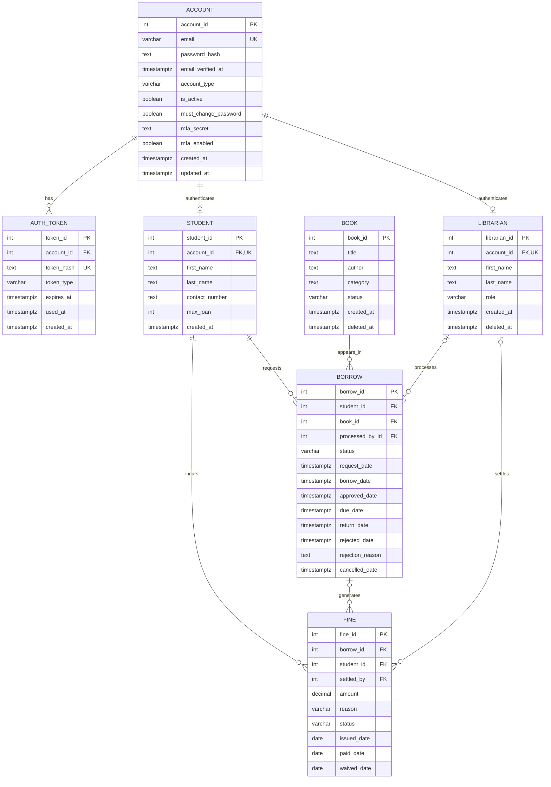

# LBLMS — Entity Relationship Diagram (ERD)

**System:** Library Borrowing & Loan Management System  
**Database:** PostgreSQL (Neon; manageable through pgAdmin 4)  
**Schema:** Seven tables — `account`, `student`, `librarian`, `book`, `borrow`, `fine`, `auth_token`  
**Source of truth:** `LBLMS_Neon_PostgreSQL_Schema.sql`

## 1. Entities and attributes

**Legend:** PK = Primary Key; FK = Foreign Key; UQ = Unique; NN = Not Null. Nullable unless noted otherwise.

### ACCOUNT
| Attribute | PostgreSQL type | Key / constraint |
|---|---|---|
| account_id | INTEGER IDENTITY | PK |
| email | VARCHAR(255) | NN, UQ |
| password_hash | TEXT | NN |
| email_verified_at | TIMESTAMPTZ | Nullable; NULL means unverified |
| account_type | VARCHAR(12) | NN; `Student` or `Staff` |
| is_active | BOOLEAN | NN; default `TRUE` |
| must_change_password | BOOLEAN | NN; default `FALSE` |
| mfa_secret | TEXT | Nullable |
| mfa_enabled | BOOLEAN | NN; default `FALSE` |
| created_at | TIMESTAMPTZ | NN; default `NOW()` |
| updated_at | TIMESTAMPTZ | NN; default `NOW()`; updated by trigger |

**Constraint:** When `mfa_enabled = TRUE`, `mfa_secret` must not be null. Encrypt MFA secrets at rest.

### AUTH_TOKEN
| Attribute | PostgreSQL type | Key / constraint |
|---|---|---|
| token_id | INTEGER IDENTITY | PK |
| account_id | INTEGER | FK → `account.account_id`; NN |
| token_hash | TEXT | NN, UQ; SHA-256 hex digest |
| token_type | VARCHAR(30) | NN; `email_verification` or `password_reset` |
| expires_at | TIMESTAMPTZ | NN; after created_at |
| used_at | TIMESTAMPTZ | Nullable; single-use consumption time |
| created_at | TIMESTAMPTZ | NN; default `NOW()` |

### STUDENT
| Attribute | PostgreSQL type | Key / constraint |
|---|---|---|
| student_id | INTEGER GENERATED ALWAYS AS IDENTITY (START WITH 192021) | PK; automatically assigned |
| account_id | INTEGER | FK → `account.account_id`; NN, UQ |
| first_name | TEXT | NN |
| last_name | TEXT | NN |
| contact_number | TEXT | Nullable |
| max_loan | INTEGER | NN; default 5; CHECK = 5 |
| created_at | TIMESTAMPTZ | NN; default `NOW()` |

### LIBRARIAN
| Attribute | PostgreSQL type | Key / constraint |
|---|---|---|
| librarian_id | INTEGER GENERATED BY DEFAULT AS IDENTITY (START WITH 1209022) | PK; Superlibrarian fixed at 1209021 |
| account_id | INTEGER | FK → `account.account_id`; NN, UQ |
| first_name | TEXT | NN |
| last_name | TEXT | NN |
| role | VARCHAR(20) | NN; `Librarian` or `Superlibrarian` |
| created_at | TIMESTAMPTZ | NN; default `NOW()` |
| deleted_at | TIMESTAMPTZ | Nullable; soft deletion |

**ID constraint:** Superlibrarian ID must be 1209021; Librarian IDs must be at least 1209022.

**Constraint:** A partial unique index permits at most one non-deleted `Superlibrarian` profile. Ensuring one *active* Superlibrarian always exists requires application logic.

### BOOK
Each row represents **one physical book copy**. The retained partial unique index on normalized title and author prevents multiple non-deleted copies with the same title and author.

| Attribute | PostgreSQL type | Key / constraint |
|---|---|---|
| book_id | INTEGER IDENTITY | PK |
| title | TEXT | NN |
| author | TEXT | NN |
| category | TEXT | NN |
| status | VARCHAR(20) | NN; default `Available`; `Available`, `Borrowed`, `Lost`, `Damaged` |
| created_at | TIMESTAMPTZ | NN; default `NOW()` |
| deleted_at | TIMESTAMPTZ | Nullable; soft deletion |

### BORROW
| Attribute | PostgreSQL type | Key / constraint |
|---|---|---|
| borrow_id | INTEGER IDENTITY | PK |
| student_id | INTEGER | FK → `student.student_id`; NN |
| book_id | INTEGER | FK → `book.book_id`; NN |
| processed_by_id | INTEGER | FK → `librarian.librarian_id`; nullable |
| status | VARCHAR(20) | NN; default `pending`; `pending`, `active`, `returned`, `rejected`, `cancelled` |
| request_date | TIMESTAMPTZ | NN; default `NOW()` |
| borrow_date | TIMESTAMPTZ | Nullable |
| approved_date | TIMESTAMPTZ | Nullable |
| due_date | TIMESTAMPTZ | Nullable |
| return_date | TIMESTAMPTZ | Nullable |
| rejected_date | TIMESTAMPTZ | Nullable |
| rejection_reason | TEXT | Nullable |
| cancelled_date | TIMESTAMPTZ | Nullable |

**Constraints:**
- At most one `active` borrow per book (`UNIQUE` partial index on `book_id`).
- An `active` borrow requires `borrow_date`, `approved_date`, `due_date`, and `processed_by_id`.
- A `returned` borrow requires `borrow_date`, `due_date`, and `return_date`.
- `rejected` requires `rejected_date`; `cancelled` requires `cancelled_date`.
- `due_date > borrow_date` and `return_date >= borrow_date` when both dates are present.

### FINE
| Attribute | PostgreSQL type | Key / constraint |
|---|---|---|
| fine_id | INTEGER IDENTITY | PK |
| borrow_id | INTEGER | FK → `borrow.borrow_id`; nullable for manually issued fines |
| student_id | INTEGER | FK → `student.student_id`; NN |
| settled_by | INTEGER | FK → `librarian.librarian_id`; nullable |
| amount | NUMERIC(10,2) | NN; CHECK > 0 |
| reason | VARCHAR(20) | NN; `Overdue`, `Damaged`, `Lost` |
| status | VARCHAR(20) | NN; default `unpaid`; `unpaid`, `paid`, `waived` |
| issued_date | DATE | NN; default `CURRENT_DATE` |
| paid_date | DATE | Nullable |
| waived_date | DATE | Nullable |

**Constraints:** Paid fines require `paid_date`; waived fines require `waived_date`; unpaid fines require neither. Only one `Overdue` fine can reference a particular borrow, but additional `Damaged` or `Lost` fines may reference it.

## 2. Relationships and cardinalities

| Parent → Child | Cardinality | Foreign key |
|---|---|---|
| ACCOUNT → AUTH_TOKEN | 1 → 0..many | `auth_token.account_id` |
| ACCOUNT → STUDENT | 1 → 0..1 | `student.account_id` (unique) |
| ACCOUNT → LIBRARIAN | 1 → 0..1 | `librarian.account_id` (unique) |
| STUDENT → BORROW | 1 → 0..many | `borrow.student_id` |
| BOOK → BORROW | 1 → 0..many (historically) | `borrow.book_id` |
| LIBRARIAN → BORROW | 1 → 0..many; staff required for active loans; otherwise nullable | `borrow.processed_by_id` |
| STUDENT → FINE | 1 → 0..many | `fine.student_id` |
| BORROW → FINE | 1 → 0..many; fine borrow optional | `fine.borrow_id` |
| LIBRARIAN → FINE | 1 → 0..many; fine settlement staff optional | `fine.settled_by` |

Every STUDENT and LIBRARIAN row belongs to exactly one ACCOUNT. The database's FKs do not by themselves prevent an ACCOUNT from having both profile types; FastAPI must validate that the profile matches `account_type`.

## 3. ERD diagram (Mermaid)

## 4. Borrowing and security rules

These rules are **application-level** unless noted as a database constraint:

1. **Five-item limit:** A student may have no more than five combined `pending` + `active` borrows. Lock the student row and recheck inside a transaction.
2. **Loan period:** Approval or direct desk issuance activates a borrow. Set `borrow_date` and `approved_date` to the issuance time; set `due_date = borrow_date + INTERVAL '14 days'`.
3. **Book availability:** Pending requests do not change BOOK status. Approval changes it to `Borrowed` and rejects competing pending requests in the same transaction.
4. **One active loan per physical copy:** Enforced by a PostgreSQL partial unique index; also lock the book row during approval.
5. **Overdue fines:** ₱5 per overdue calendar day per item. Unpaid recorded fines **or accrued but unrecorded overdue amounts** block new requests and loans, but not returns.
6. **Fine settlement:** Only authorized staff record payments or waivers, including `settled_by` and the settlement date. Students only view fines. Staff attribution is enforced by FastAPI; no additional database CHECK requires `settled_by`.
7. **Authorization:** Student accounts use STUDENT profiles; staff use LIBRARIAN profiles. Only the Superlibrarian manages librarian accounts.
8. **MFA:** Mandatory for staff; optional for students. New librarians must change their temporary password and enroll in MFA. Encrypt TOTP secrets.
9. **Superlibrarian protection:** Keep exactly one designated active Superlibrarian; prevent accidental deactivation or deletion.
10. **History preservation:** Soft-delete books and librarians. All seven tables use restrictive foreign-key deletion behavior to protect referenced history.

11. **Staff accountability:** The current frontend may approve without a processor. The backend intentionally requires `processed_by_id` from the authenticated staff identity for approvals and direct issuance; preserve it on return.
12. **Authentication tokens:** Generate tokens using `secrets.token_urlsafe(32)`; store only SHA-256 hashes. Verification expires after 24 hours and password reset after 15 minutes. Send raw tokens only in HTTPS email links through Resend. Validate account, purpose, expiry and unused status; consume tokens atomically with the account update. Serialize issuance and consumption by locking the account row. On resend, delete previous unused tokens of the same type. Rate-limit requests and return generic reset responses. After password reset, invalidate existing sessions (session revocation mechanism to be designed during backend implementation). Never log raw tokens. Student sign-in requires verified email; staff provisioning and verification policy remains to be specified.

## 5. Implementation notes

- **Backend:** FastAPI + SQLAlchemy + Alembic.
- **Database:** Neon PostgreSQL; pgAdmin 4 can connect to the same Neon database.
- **Frontend:** React, connected to FastAPI endpoints rather than directly to Neon.
- **Status values are case-sensitive:** BOOK uses `Available`/`Borrowed`/`Lost`/`Damaged`, while BORROW and FINE use lowercase statuses.
- **Schema vs. rules:** PostgreSQL enforces keys, checks, and unique indexes; FastAPI transactions enforce cross-row business rules and account/profile consistency.
